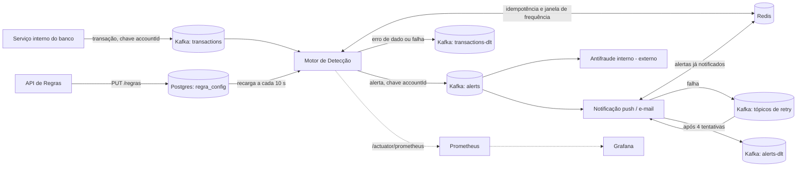

# Motor de Detecção de Transações Suspeitas

Case técnico – Engenharia de Software Backend (Itaú).

O motor recebe eventos de transações em tempo real pelo Kafka, aplica regras de detecção configuráveis e publica alertas num tópico que o antifraude interno e a notificação ao cliente podem consumir. O foco foi uma fatia ponta a ponta funcionando, com as decisões, simplificações e limitações documentadas.

## Arquitetura

Diagrama da arquitetura-alvo: [docs/arquitetura-motor-antifraude.drawio](docs/arquitetura-motor-antifraude.drawio) (abre no draw.io). O esquema abaixo mostra o que está implementado. Circuit breaker, base de clientes e o bloco de segurança do diagrama ainda são proposta; e, ao contrário do diagrama, a API de regras e a notificação rodam dentro do motor, e existe também a `transactions-dlt`.



Setas cheias são o fluxo dos dados; setas tracejadas, as métricas.

- **Kafka, tópico `transactions`** (24 partições): o contrato esperado do produtor é usar `accountId` como chave, para que as transações de uma conta fiquem na mesma partição, em ordem.
- **Motor (Java 21, Spring Boot 4.2):** valida o evento, checa idempotência, aplica as regras ativas e publica o alerta.
- **Redis:** idempotência por `eventId`, janelas deslizantes da regra de frequência e registro de notificações já enviadas (`notif:<alertaId>`).
- **Postgres:** cadastro das regras (tabela `regra_config`).
- **Kafka, tópico `alerts`** (chave `accountId`): desacopla a detecção de quem consome o alerta. O `alertaId` é a chave de idempotência que todo consumidor deve usar.
- **Notificação:** consome `alerts` com retry em tópicos e DLQ (`alerts-dlt`), e descarta alertas já notificados.
- **Prometheus:** coleta as métricas do motor em `/actuator/prometheus`.
- **Grafana:** sobe sem datasource nem painel; precisa ser apontado ao Prometheus manualmente.

## Como rodar

Pré-requisitos: Docker e Java 21+.

```bash
# 1. infraestrutura (Kafka, Redis, Postgres, Prometheus, Grafana)
docker compose up -d

# 2. motor (cria os tópicos ao subir)
cd motor-deteccao
./mvnw spring-boot:run
```

O motor não tem página na raiz (abrir `localhost:8080` dá 404). Para conferir se subiu: `curl localhost:8080/actuator/health`.

Criar as regras (em outro terminal). O PUT substitui a regra inteira, então envie sempre todos os campos:

```bash
curl -X PUT localhost:8080/regras/VALOR_ALTO -H "Content-Type: application/json" \
  -d '{"tipo":"VALOR_ALTO","limite":10000,"ativa":true}'

curl -X PUT localhost:8080/regras/FREQUENCIA -H "Content-Type: application/json" \
  -d '{"tipo":"FREQUENCIA","limite":5,"janelaSegundos":120,"ativa":true}'

# conferir
curl localhost:8080/regras
```

Enviar uma transação com chave `accountId` (na raiz do projeto):

```bash
echo 'conta-123|{"eventId":"ev-1","transactionId":"tx-1","accountId":"conta-123","valor":15000.00,"pais":"BR","estabelecimento":"Loja X","dataHora":"2026-11-25T12:00:00Z"}' \
  | docker compose exec -T kafka /opt/kafka/bin/kafka-console-producer.sh --bootstrap-server localhost:9092 --topic transactions \
    --property parse.key=true --property key.separator='|'
```

No log do motor aparecem `SUSPEITA: transação tx-1 quebrou a regra VALOR_ALTO` e `Notificação enviada para o alerta tx-1:VALOR_ALTO`. Cada novo teste precisa de um `eventId` novo: um `eventId` já processado é ignorado por 24 h (é a idempotência funcionando).

Ver os alertas:

```bash
docker compose exec kafka /opt/kafka/bin/kafka-console-consumer.sh --bootstrap-server localhost:9092 --topic alerts --from-beginning
```

Conferir se o Prometheus coleta o motor (deve responder `"health":"up"`):

```bash
curl -s localhost:9090/api/v1/targets | grep -o '"health":"[a-z]*"'
```

Testes unitários e cobertura (não precisam de Docker):

```bash
cd motor-deteccao
./mvnw test -Dtest='*RegraTest,IdempotenciaServiceTest,TransacaoListenerTest,RegraCacheTest,Notificacao*Test'
# relatório: target/site/jacoco/index.html
```

Um `./mvnw test` sem filtro também roda o `contextLoads`, que precisa da infraestrutura no ar.

## Demonstrações

Todas rodam na raiz do projeto, com o motor no ar e as regras criadas. A transação `tx-1` da seção anterior já deve ter sido enviada.

### 1. Regra alterada sem redeploy

Baixar o limite de valor alto para 5.000:

```bash
curl -X PUT localhost:8080/regras/VALOR_ALTO -H "Content-Type: application/json" \
  -d '{"tipo":"VALOR_ALTO","limite":5000,"ativa":true}'
```

Esperar uns 10 segundos e mandar uma transação de 7.000, que antes não geraria alerta:

```bash
echo 'conta-123|{"eventId":"ev-2","transactionId":"tx-2","accountId":"conta-123","valor":7000.00,"pais":"BR","estabelecimento":"Loja X","dataHora":"2026-11-25T12:01:00Z"}' \
  | docker compose exec -T kafka /opt/kafka/bin/kafka-console-producer.sh --bootstrap-server localhost:9092 --topic transactions \
    --property parse.key=true --property key.separator='|'
```

Esperado no log: `SUSPEITA: transação tx-2 quebrou a regra VALOR_ALTO`.

### 2. Notificação fora do ar

```bash
curl -X PUT localhost:8080/simulacao/notificacao/false

echo 'conta-123|{"eventId":"ev-3","transactionId":"tx-3","accountId":"conta-123","valor":8000.00,"pais":"BR","estabelecimento":"Loja X","dataHora":"2026-11-25T12:02:00Z"}' \
  | docker compose exec -T kafka /opt/kafka/bin/kafka-console-producer.sh --bootstrap-server localhost:9092 --topic transactions \
    --property parse.key=true --property key.separator='|'
```

Esperado no log: o motor continua detectando (`SUSPEITA` para tx-3); a notificação tenta 4 vezes e registra `Alerta foi para a DLQ depois de 4 tentativas`. Para conferir a DLQ e religar:

```bash
docker compose exec kafka /opt/kafka/bin/kafka-console-consumer.sh --bootstrap-server localhost:9092 --topic alerts-dlt --from-beginning --timeout-ms 5000

curl -X PUT localhost:8080/simulacao/notificacao/true
```

### 3. Mensagem inválida

```bash
echo 'conta-123|{isso nao e json' \
  | docker compose exec -T kafka /opt/kafka/bin/kafka-console-producer.sh --bootstrap-server localhost:9092 --topic transactions \
    --property parse.key=true --property key.separator='|'

docker compose exec kafka /opt/kafka/bin/kafka-console-consumer.sh --bootstrap-server localhost:9092 --topic transactions-dlt --from-beginning --timeout-ms 5000
```

Esperado: a mensagem vai direto para a `transactions-dlt`, sem retry, e aparece no consumidor. O `TimeoutException` no fim é só o consumidor parando depois de 5 segundos.

### 4. Idempotência

Mandar de novo exatamente a mesma transação `tx-2` (mesmo `eventId`):

```bash
echo 'conta-123|{"eventId":"ev-2","transactionId":"tx-2","accountId":"conta-123","valor":7000.00,"pais":"BR","estabelecimento":"Loja X","dataHora":"2026-11-25T12:01:00Z"}' \
  | docker compose exec -T kafka /opt/kafka/bin/kafka-console-producer.sh --bootstrap-server localhost:9092 --topic transactions \
    --property parse.key=true --property key.separator='|'
```

Esperado no log: o evento é registrado como já processado e ignorado; não há novo `SUSPEITA` nem nova notificação.

## Requisitos do case

| Requisito | Situação | Como |
|---|---|---|
| Receber eventos em tempo real | Feito | Consumidor Kafka no tópico `transactions`, 6 threads por instância |
| Lógica de detecção | Feito | Regras de valor alto e de frequência (janela deslizante) |
| Alertas internos e externos | Feito | Tópico `alerts` para consumo interno + notificação simulada (push/e-mail) |
| Funcionar com serviço auxiliar fora | Parcial | Notificação fora: detecção segue, retry + DLQ. Postgres fora depois da subida: regras mantidas em memória. Redis fora: eventos vão para as DLQs (ver Limitações) |
| Idempotência | Feito | Dois estados no Redis por `eventId` (em processamento e concluído); notificação descarta `alertaId` repetido |
| Regras sem redeploy | Parcial | Parâmetros e ativação mudam em tempo real; um tipo novo de regra exige deploy |
| 8.000 TPS / pico 25.000 | Proposto | Arquitetura particionada para escalar horizontalmente; não medido |
| Alerta em até 500 ms | Proposto | Regras em memória, sem consulta ao Postgres por transação; falta métrica de ponta a ponta |
| Segurança e LGPD | Parcial | Ver seção Segurança |
| Observabilidade | Parcial | Métricas coletadas pelo Prometheus; faltam a métrica de latência, o painel e os alertas |

## Decisões técnicas e trade-offs

**Kafka em vez de RabbitMQ.** Minha experiência anterior é com RabbitMQ. Escolhi Kafka porque o case pede vazão alta e ordem por conta: com o `accountId` como chave, as regras com estado veem as transações de uma conta em ordem; o log retido permite reprocessar; e vários consumidores leem o mesmo alerta. Custo: operar Kafka é mais complexo.

**Regras como dados.** Cada regra é uma linha no Postgres; o motor relê as regras ativas a cada 10 segundos e guarda em memória. Nenhuma transação consulta o Postgres, o que protege a latência, e uma queda do Postgres depois da subida não para a detecção. Trade-off: uma mudança leva até 10 segundos para valer. Cada tipo de regra implementa a interface `Regra`; um tipo novo exige a classe e um `case` no `RegraCache`, com deploy.

**Idempotência em dois estados.** Ao chegar, o evento recebe a marca "em processamento" no Redis (`SETNX`, TTL de 5 min). Só depois de publicar todos os alertas ele vira "concluído" (TTL de 24 h). Se o processamento falhar com exceção, a marca é apagada para a nova tentativa. Se o processo cair no meio, a marca fica até expirar e o evento vai para a DLQ, em vez de ser perdido em silêncio. O `alertaId` (`transactionId:regraId`) é estável e a notificação o usa para não notificar duas vezes.

**Alerta confirmado.** O motor espera o broker confirmar o envio (`acks=all`, produtor idempotente) antes de concluir o evento. Custa latência e segura a partição enquanto espera, mas só transações suspeitas geram alerta. Com um único broker local, a durabilidade real depende de replicação em produção.

**Erros no consumo.** Falha passageira tem 3 novas tentativas (4 execuções no total), com 1 s entre elas. Erro de dado (JSON inválido, campo obrigatório vazio) vai direto para `transactions-dlt`. Na notificação, o retry usa tópicos de retry para não travar a fila.

**Simplificações conscientes.** A notificação roda no mesmo projeto, com grupo de consumidores próprio, e usa o mesmo Redis do motor; em produção seria um serviço separado, com seu próprio armazenamento. Push e e-mail são simulados. O endpoint `/simulacao` existe só para a demo.

## Estratégia de testes

- **Unitários (JUnit 5 + Mockito):** 27 testes cobrindo regras (incluindo o limite exato), idempotência, listener (publica só quando suspeita, ignora evento concluído, falha em vez de perder evento interrompido, não esconde o erro original, rejeita evento sem `eventId` ou sem `transactionId`), cache de regras (Postgres fora do ar, tipo inválido) e notificação (não reenvia alerta repetido). Os demais campos obrigatórios são validados no código, mas ainda sem teste.
- **Cobertura (JaCoCo):** cerca de 77% das instruções e 76% dos desvios nos unitários. Ficaram sem cobertura os controllers, a classe main, o `AlertaPublisher` e o `KafkaConfig`, que pedem testes de integração.
- **Testes manuais de ponta a ponta:** os roteiros da seção Demonstrações, executados com Kafka, Redis e Postgres reais.
- **Revisão com agentes de IA:** quatro rodadas (a quarta só conferiu a documentação), com os relatórios em `docs/revisao-ia/`. Ver [AI_USAGE.md](AI_USAGE.md).
- **Análise estática:** SpotBugs e PMD foram testados e retirados (falsos positivos e incompatibilidade com o JDK 25 do ambiente). Fica como evolução.
- **Próximos:** integração com Testcontainers ou `@EmbeddedKafka`, testes de ordem (publicar antes de concluir) e teste de carga com k6 ou Gatling.

## Segurança e LGPD

- **Feito:** os logs do motor e da notificação não trazem `accountId` nem valores; a DLT da notificação não registra o payload. Mensagens de erro do framework para JSON malformado podem incluir o trecho rejeitado.
- **Em trânsito (proposta):** TLS no Kafka, Redis e Postgres; mTLS entre serviços.
- **Autenticação (proposta):** API de regras atrás de OAuth2/JWT, com perfil de acesso para o time antifraude e auditoria de cada mudança.
- **Em repouso (proposta):** discos e backups criptografados; segredos fora do repositório (hoje a senha local está no `application.properties`, aceitável só em desenvolvimento).
- **LGPD (proposta):** o evento carrega só o necessário (ids, valor, país, estabelecimento); CPF e cartão, se entrarem, mascarados ou tokenizados; retenção definida para tópicos e DLQs, que hoje guardam o payload completo sem retenção própria.

## Observabilidade e operação (proposta para SRE)

- **Métricas:** vazão por tópico, lag do consumidor, latência evento → alerta (p99), taxa de alertas por regra, tamanho das DLQs.
- **Alertas de incidente:** queda de vazão ou lag crescendo; DLQ recebendo mensagens; aumento súbito de alertas de uma regra (possível falso positivo, que pode ser desativada pela API sem deploy); dependência fora do ar.
- **Logs e tracing:** logs estruturados com `transactionId` e tracing distribuído com OpenTelemetry.

## Limitações conhecidas

- Vazão e latência não foram medidas.
- Ninguém reprocessa `transactions-dlt` e `alerts-dlt` (a `alerts-dlt` só gera um log de erro): o que cai lá precisa de replay manual.
- Se o motor cair no meio de um evento, a nova entrega encontra a marca "em processamento" e o evento vai para a DLQ, porque o retry (cerca de 3 s) é mais curto que o TTL da marca (5 min).
- O Redis é ponto único de falha: fora do ar, transações e notificações vão para as DLQs.
- O tópico `alerts` pode receber o mesmo alerta mais de uma vez; a notificação descarta repetidos, mas a verificação não é atômica, e outros consumidores precisam deduplicar pelo `alertaId`.
- O cache de regras começa vazio: eventos consumidos antes da primeira carga são concluídos sem avaliação.
- A API de regras não tem autenticação nem validação de entrada. Uma regra VALOR_ALTO sem limite faz toda transação falhar e ir para a `transactions-dlt`. Uma regra com tipo inválido, ou FREQUENCIA com campo nulo, impede a recarga de todas as regras: o cache fica na última versão válida e o log atribui o erro ao Postgres.
- Os tópicos de retry da notificação são criados com menos partições que o `alerts`; o Kafka redistribui (aparece um aviso no log) e o retry funciona, mas o ideal é criá-los com o mesmo número de partições.
- Tópicos com fator de replicação 1 fixo no código; a regra de frequência faz 4 comandos não atômicos no Redis; o `/simulacao` não está restrito a um perfil de demo.
- A notificação não tem circuit breaker.

## Evoluções

1. Fechar o ciclo da DLQ: retry mais longo que o TTL para evento "em processamento", reprocessador, métrica e alarme.
2. Notificação como serviço separado, com deduplicação atômica própria e que continue enviando com o Redis fora.
3. Teste de carga para provar 8k/25k TPS e métrica de latência ponta a ponta com painel no Grafana.
4. Carregar as regras antes de começar a consumir; validar a API e tornar o PUT parcial seguro.
5. Partições e replicação por ambiente, com tópicos (incluindo os de retry) criados pela plataforma.
6. Regra de frequência atômica com script Lua; circuit breaker (Resilience4j).
7. Novas regras (localização impossível, regra composta) e deploy em Kubernetes com autoscaling pelo lag.

## Uso de IA

Detalhado em [AI_USAGE.md](AI_USAGE.md).